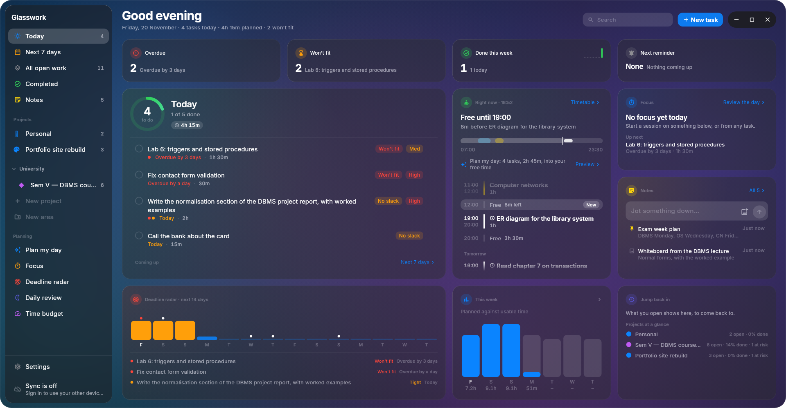
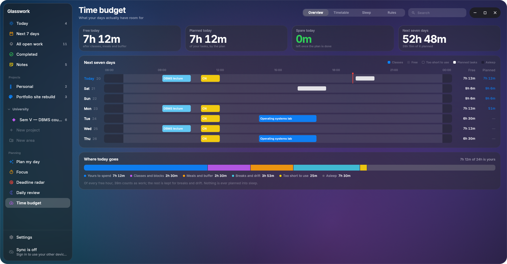
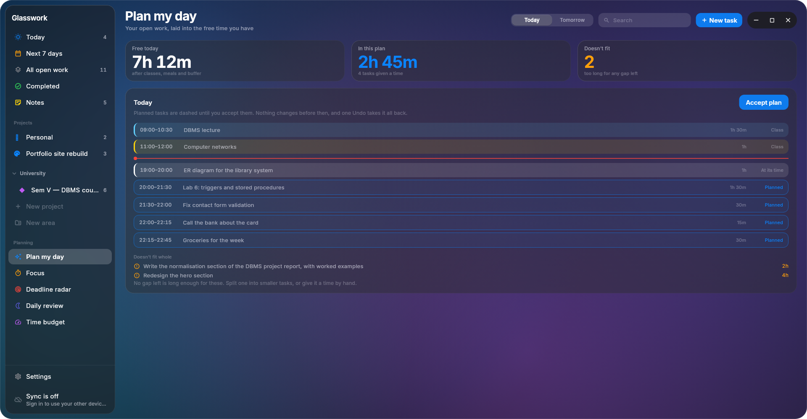
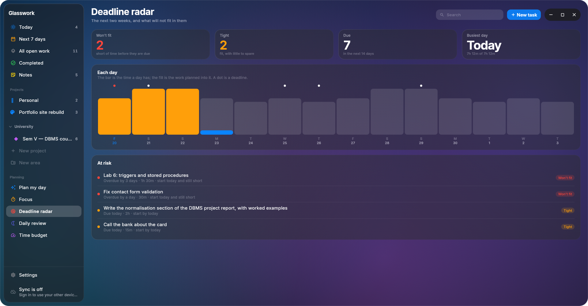
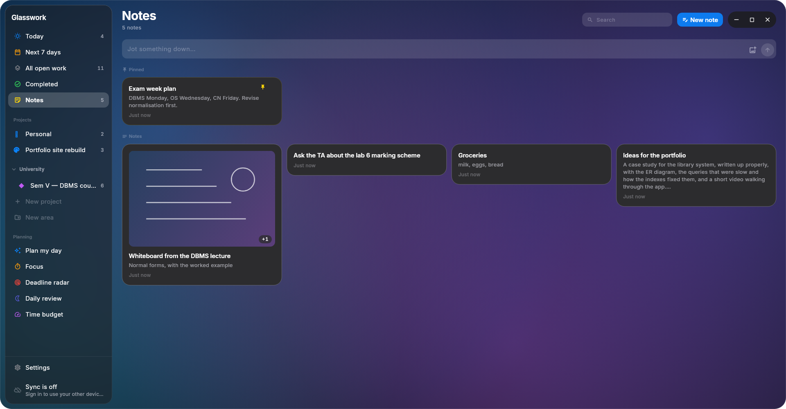

# Glasswork

[](https://github.com/MrHyperIon101/glasswork/actions/workflows/checks.yml)

A task app that plans against the hours you actually have, rather than the ones you wish you
had. Local-first, cloud-synced, Linux and Android.



## Why it exists

Every task app I tried would happily accept "finish the report by Friday" without ever asking
whether Friday had room in it. They keep a list of promises and leave the arithmetic to you —
which means the arithmetic arrives the night before three things are due at once.

Glasswork does the arithmetic. It knows when I sleep, what my week already has in it and how
long my work takes, so it can say what is genuinely left while a task is being added, not
afterwards. Everything else in the app exists so that answer is always to hand: the same work on
the laptop and the phone, and every screen fully usable with no signal at all.

I use it every day, which is the only reason it has as few rough edges as it does.

## What it does

- **Today** — one screen that knows your day: what is due and what won't fit, where the day
  stands right now, the one task to start next, focus so far, the next two weeks' deadlines,
  this week's load, notes and where to jump back in. Every figure traces back to a tested
  function.
- **Time budget** — sleep, classes and fixed blocks taken out of the day, then meals and a
  buffer, and what is left multiplied by a focus factor *per gap*, because six free hours in one
  block is not six hours in twenty-minute slivers. Tasks are then allocated from one shared pool
  in deadline order, so two of them can never both claim the same Wednesday. It shows its
  working in four tabs: the next seven days on one clock and where today's 24 hours go; the
  timetable as a week grid you click into; each night as a bar against your sleep goal; and the
  rules, with today's figures changing as you step them.
- **Plan my day** — today's (or tomorrow's) open work laid into the free time around your
  classes, in deadline order, never into sleep. Shown dashed first; one click accepts it all, one
  Undo takes it all back.
- **Focus** — a timer you start on a task, with breaks, that keeps the time it tracked. Your
  focus per day and per task, the streak, and tracked time against each estimate.
- **Deadline radar** — the next fourteen days, each one's work against its time, every deadline
  marked, and each task that won't fit or only just, with why.
- **Daily review** — in the evening: what got done, what slipped (move it, drop it, or mark it
  done), focus against the plan, and tomorrow planned before it starts.
- **Adding that reads you** — "lab report next fri 5pm @dbms for 2h !high" becomes a task with
  its project, time, estimate and priority, all offline. Similar past tasks suggest the project
  and an estimate from what they really took, and while you type it says whether the task fits
  before its deadline — and finds a time for it.
- **Tasks with a time** — give a task a time and it lands on the time budget for that day,
  counts in its figures, and sits beside your classes. One field, nothing to keep in step.
- **Timetables** — a set of blocks per semester, with dates, so a horizon that crosses a
  changeover gets the right classes on each side of it.
- **Projects and areas** — boards with sections, custom fields, saved views and labels; projects
  grouped into areas you name, each with an icon or emoji of your choosing.
- **Notes** — quick notes with images, kept with the rest of your work.
- **Reminders** — exact alarms on Android; on Linux the app raises them while it is open and
  writes a systemd timer for while it is closed.
- **Sync** — optional, through a Supabase project of your own. Every write hits the device first
  and reconciles later, so nothing ever waits on a network.
- **Undo** — anything destructive can be taken back for five seconds.
- **Spotlight, for the whole desktop** — on GNOME, Super+Space opens a Spotlight laid out and
  moving like macOS Tahoe's: apps, files, settings, the calculator, system actions and the web,
  with your tasks, notes and projects among them. Browse Applications, Files, Actions and
  Clipboard from the four buttons beside the bar or with Ctrl+1 to 4, run an action by its quick
  key (`nt` is a new task), and add the line you typed as a task with Ctrl+Return. On the phone,
  and anywhere without the extension, Ctrl+K or the search button opens the same Spotlight in
  the app.
- **Liquid glass** — every card bends and lights what is behind it, and on GNOME the window
  itself is frosted glass over your desktop.

<p align="center">
  
  
</p>
<p align="center">
  
  
</p>

## Under the hood

The parts I would point at first.

**Two clocks, never conflated.** `updated_at` is the server's, and it does exactly one job: it
is a pull cursor. Conflicts are ordered by a hybrid logical clock the client stamps per field.
Order them by server time instead and they resolve *backwards* — a stale offline edit that syncs
on Wednesday beats the fresher edit that synced on Tuesday. Writes go through a single
`merge_rows` RPC that merges field by field, and devices hold no write grant on any table at
all. The outbox carries changed fields, never row snapshots, because a full-row write clobbers
fields the device never touched. Delta pull reads from `cursor - 60s`, since `now()` is
transaction-*start* time and a long transaction can commit behind a cursor you have already
passed; the merge is idempotent, so the overlap is free.

**The capacity engine is a pure function.** `(tasks, commitments, profile, today) -> Schedule`:
no I/O, no clock of its own, every number golden-tested. It is one forward pass in deadline
order over a shared pool (Jackson's rule), not a per-task backward walk — a backward walk
double-counts the moment two tasks want the same Wednesday. Sleep is a floor and not a resource:
no code path may schedule into it or offer it as a fix. When the only way to fit everything is
to eat sleep, the app says so and asks what comes off the list instead.

**Local-first is absolute.** No UI path awaits a network call. Every write hits SQLite, renders
immediately, and queues in an outbox; other devices hear about it over realtime, with an
interval pull as the safety net. Nothing synced is ever hard-deleted. Ordering is a fractional
index string with a client-id tiebreak, because two offline devices inserting between the same
neighbours generate the identical key. Rows that can exist only once take a derived id, so both
devices create the same row offline and the merge folds them into one.

**The architecture is held up by tests, not by discipline.** `test/sync/write_path_test.dart`
reads the source and fails if a repository writes a synced table outside `SyncWriter` — the bug
it prevents is an edit that works on this device and silently never reaches another, which no
behavioural test would catch. The layout harness renders every screen and sheet at four sizes
with realistic data and fails on an overflow, or on text squeezed into a column of single
letters; it also writes the screenshots in this file. Another test reads the Linux runner to
check the tray is built before the Flutter view, because a realised `FlView` answers the close
request first — an edit that reordered them would quietly turn "keep in the tray" back into
"quit".

**The native side is mine too.** The Linux runner is a single-instance GTK application in C,
with a tray that `dlopen`s AppIndicator rather than linking it, so the app still starts on a
desktop that has none. It ships as one file: a small GTK installer program with the app appended
as a tarball, which unpacks beside an existing installation and swaps the two with renames, so a
failed update leaves the working app exactly where it was — and the same file uninstalls, from
the app grid entry's own menu. Images are turned upright, downscaled and encoded in platform
code, on both platforms, before Dart sees a byte of them.

**Liquid glass, with the numbers to back it.** Every card is a fragment shader run as a backdrop
filter: it bends what is behind along its rim, splits the colours slightly there, and catches a
light from the top left, over a slowly drifting backdrop painted rather than captured. The shader
works in the window's pixels, so each surface tells it where it is as it paints; every surface on
a screen shares one capture; and cards skip the blur that only floating surfaces need. That
measures 3.4 ms of raster at p50 at 1080p on a 165 Hz screen. Under it, Apple's real dark palette
rather than an approximation of it, and every colour, space, radius and control height out of a
single tokens file.

`docs/architecture.md` is the long version, including the rules I hold myself to.

## Install

**Linux** — download `Glasswork-Setup-<version>-x86_64` from
[Releases](../../releases), make it executable and open it:

```bash
chmod +x Glasswork-Setup-*-x86_64 && ./Glasswork-Setup-*-x86_64
```

It installs into `~/.local/opt/dev.mrhyperion.glasswork` with an app grid entry, or updates
what is already there. Nothing needs root, and your data is never touched. The same file
uninstalls it from the app entry's menu.

On GNOME it also installs Glasswork Spotlight, the shell extension behind Super+Space. GNOME
starts a new extension only with a new session, so log out and back in once. It takes
Super+Space from GNOME's keyboard-layout switching; the shortcut, the clipboard history and
the rest are in its settings, in the Extensions app.

**Android** — download the `arm64-v8a` APK from the same release and open it. It is signed
with a debug key, so Android will ask you to allow installing from an unknown source.

The binaries on the releases page are built without any server configuration, so they keep
everything on the device and nothing of yours goes anywhere. Sync needs a Supabase project
of your own — see below.

## Building it yourself

You need Flutter 3.47, and on Linux the GTK 3 development files
(`gtk3` on Arch, `libgtk-3-dev` on Debian). Not 3.50.0: on NVIDIA GPUs it draws every frame
half a window out of place ([flutter/flutter#196083](https://github.com/flutter/flutter/pull/196083),
fixed for 3.50.1), and the installer build refuses it. To build with a second SDK, put it in
`FLUTTER`:

```bash
FLUTTER=~/.local/share/flutter-3.47.4/bin/flutter linux/packaging/build_installer.sh
```

```bash
flutter pub get
flutter run -d linux            # or: flutter run -d <your phone>
```

To package the Linux installer, which builds the release app first:

```bash
linux/packaging/build_installer.sh
# → build/linux/installer/Glasswork-Setup-<version>-x86_64
```

It picks up `backend.json` if you have one; `GLASSWORK_NO_BACKEND=1` leaves it out, which is
how the released file is built.

For the phone:

```bash
flutter build apk --release --split-per-abi \
  --android-project-arg=force-version-code-ignoring-abi=true
```

Bump the version in `pubspec.yaml` **and** `AppConfig.version` for every release — a test
holds the two together, and the installer uses it to tell an update from a reinstall.

## Syncing with your own Supabase project

Skip this and the app still works; it simply keeps everything on the one device.

1. Create a project on Supabase. The free plan is enough.
2. Apply the schema, which creates every table, its row level security, the realtime
   publication and the private bucket that note images live in:

   ```bash
   supabase link --project-ref <your project ref>
   supabase db push
   ```

3. Point the app at it:

   ```bash
   cp backend.example.json backend.json     # then fill in your URL and publishable key
   ```

   `backend.json` is ignored by git, and the build scripts pick it up. For a one-off run:
   `flutter run -d linux --dart-define-from-file=backend.json`.

4. Check the server agrees with the app:

   ```bash
   supabase db query --linked -f supabase/checks/sync_schema_checks.sql
   ```

   A good run ends with `ALL SYNC SCHEMA CHECKS PASSED`.

   Updating from an earlier release, run `supabase db push` again before the new build first
   syncs: 0.6 adds the table focus sessions are kept in.

Sign in on each device with the same email and password. The first device claims the account;
the second is asked whether to combine its work with what is already there or take the
account's instead.

## Tests

```bash
flutter analyze
flutter test
gjs -m linux/gnome-extension/tests/run.js
```

847 of them, and they are where the design is enforced rather than merely described: the
capacity arithmetic against golden schedules, the sync merge across two simulated devices and a
fake server, the repositories, every pure text and layout function, and the harness above. The
server has its own — `supabase/checks/sync_schema_checks.sql` asserts the tables, policies and
grants against a real Postgres, in a transaction that always rolls back.

## Where it stops

Linux and Android. No web, no iOS, no Windows, no teams or sharing — the schema allows other
people, the app does not ship it. Images are the only attachment. Light mode is not built,
though the palette is structured for it.

The list is short on purpose. I would rather five things worked properly than fifteen nearly
did.

## Licence

[MIT](LICENSE). Take anything in here that is useful to you.
